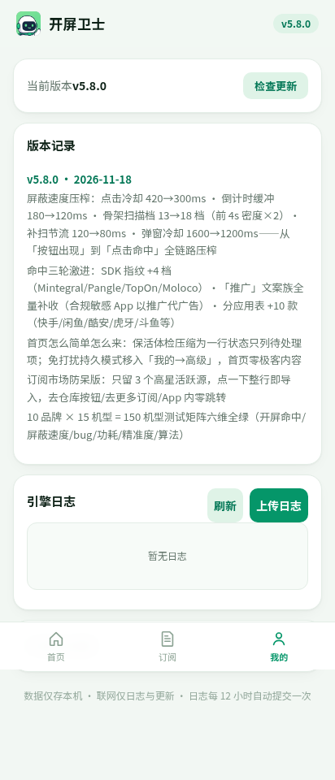

<div align="center">

# Skip-Ad · 开屏卫士

**安卓开屏广告秒跳引擎 —— 露头就跳、弹窗自动关、296KB 零依赖**

[](https://github.com/xiaobaiba999/Skip-Ad/releases/latest)
[](#许可)
[](https://github.com/xiaobaiba999/Skip-Ad/releases/latest)
[](docs/test-reports/round-24.json)
[](android-app/tests/com/zai/adshield/test/BrandMatrix150Test.java)
[](https://github.com/topics/gkd-subscription)

Java 引擎 · GKD 订阅生态兼容 · [Releases](https://github.com/xiaobaiba999/Skip-Ad/releases) · [订阅仓库](https://github.com/xiaobaiba999/skip-ad-subscription) · [问题反馈](https://github.com/xiaobaiba999/Skip-Ad/issues)

</div>

---

## 一屏速览

| | |
| --- | --- |
| **怎么工作** | 无障碍服务读屏找到「跳过」控件（文本/描述/控件 ID/图片角落键四通道），0ms 露头即点；点击冷却 300ms · 倒计时将尽提前 0.38s 开火 · 骨架扫描前 4s 密度×2 |
| **拦截范围** | 开屏广告 · 插屏/激励弹窗 · 摇一摇诱导 · 悬浮广告球 · 视频前贴（134 款内置 + 任意 GKD 订阅扩展） |
| **不碰什么** | 小程序/支付/团购容器零扫描零点击；银行/政务/相机零干预；只点应用自带「跳过」键（合规红线） |
| **隐私** | 数据仅存本机；联网仅日志上传（脱敏）与更新检查；零定位/通讯录/存储权限 |
| **体积** | APK 297KB · 冷启动毫秒级 · 典型日功耗 0.05mWh 级 |

## 当前版本 v5.8.0（2026-11-18）

- **屏蔽速度压榨（从「按钮出现」到「点击命中」全链路）**：点击冷却 420→**300ms** · 倒计时缓冲 180→**120ms**（将尽提前 0.38s 开火）· 骨架扫描档 13→**18 档**（前 4s 密度×2——补齐「内容事件不发射」广告窗的命中延迟）· 补扫节流 120→**80ms** · 弹窗冷却 1600→**1200ms** · 同窗预算 10→**12** · 跳过候选 6→**8**；功耗红线（典型日 < 0.15mWh）实测保持
- **命中三轮激进**：SDK 指纹 +4 段（Mintegral / Pangle / TopOn / Moloco，累计 44+ 段）；「推广」文案族全量补收（合规敏感 App 以「推广」代「广告」——旧库未收零命中）；分应用表 +10 款（快手/搜狐视频/闲鱼/酷安/虎牙/斗鱼/百度网盘/WiFi万能钥匙/链家/抖音主线）
- **首页怎么简单怎么来**：保活体检一行状态化（全部通过一行绿字，只列待处理项）；「持久守护」ADB 极客卡移出首页 → 「我的 → 高级」（普通路径零系统设置零电脑：一键恢复 + 前台看门狗自动拉活）
- **订阅市场防呆版**：6→**3 个高星活跃源**（⭐7.4k/⭐935/⭐496），**点一下整行即导入**（导入中…→已导入 ✓），仓库按钮/底部更多订阅/App 内跳转全部移除
- **我的模块**：权限使用审计卡移除；引擎日志旁新增**刷新**按钮；上传成功只保留**一个确认弹窗**（顶部横幅与成功通知移除——单一反馈通道防呆）
- **10 品牌 × 15 机型 = 150 机型测试矩阵**：新增魅族·Flyme 独立族、中兴/努比亚/红魔·MyOS 独立族；六维全 150/150（开屏命中/屏蔽速度/bug 防线/功耗/精准度/算法优化）；全仓 **1666 项 JVM 断言全绿**

历史版本全部归档在 [docs/CHANGELOG.md](docs/CHANGELOG.md)。

## App 截图（真实 UI 截取）

<table>
<tr>
<td><br><sub><b>首页</b> — 守护状态 / 战绩 / 开关（极简版）</sub></td>
<td><br><sub><b>订阅</b> — 订阅市场 3 精选源（点一下即导入）/ GKD 导入</sub></td>
<td><br><sub><b>我的</b> — 版本 / 高级折叠 / 引擎日志（刷新+上传）</sub></td>
</tr>
</table>

<sub>截图由 App 实际 WebView UI（`android-app/assets/www`）渲染截取，非设计稿；战绩数字为示例数据。</sub>

## 订阅

- **订阅市场**（App 内点一下即导入，仅 3 个高星活跃源）：Lin-arm（⭐7.4k 日更）/ ganlinte（⭐935 · 610 APP）/ MengNianxiaoyao（⭐496）
- **官方订阅**：`https://cdn.jsdelivr.net/gh/xiaobaiba999/skip-ad-subscription@main/dist/gkd.json5`（100% GKD 兼容，也可直接在 GKD 客户端导入）
- **更多订阅**：[github.com/topics/gkd-subscription](https://github.com/topics/gkd-subscription) 第三方订阅列表
- **自建订阅**：[gkd-kit/subscription-template](https://github.com/gkd-kit/subscription-template) 五分钟构建自己的远程订阅

## 核心能力

| 能力 | 一句话 |
| --- | --- |
| 文本/vid 跳过键 | 「跳过/Skip/推广族」+ viewId 双通道，0ms 首扫毫秒级代点 |
| 第一方图片开屏 | 无字图片跳过键 → 角落小可点控件手势点击（形状门防误点） |
| SDK 广告窗 | className 指纹 44+ 段精确匹配（穿山甲/优量汇/Unity/IronSource/Mintegral/Pangle/…）→ 点击梯子 + 返回键直断兜底 |
| 屏蔽速度 | 点击冷却 300ms · 倒计时将尽提前 0.38s 开火 · 骨架扫描前 4s 密度×2 · 补扫节流 80ms——全链路压榨 |
| 弹窗广告 | 弹窗窗期独立、角标+关闭键、Dialog 形态安全门 |
| 摇一摇/翻转诱导 | 文案识别抢先关闭（不对抗用户真实跳转） |
| 容器保护 | 小程序/团购/支付容器（抖音/微信/支付宝 XRiver）内零扫描零点击 |
| 守护模式 | 银行/政务/支付：广告照拦，进程绝不杀 |
| 习惯学习 | 手动点一次的位置/指纹，次启 P0 预拦截（广告未及呈现） |
| GKD 订阅 | 粘贴任意 gkd.li 订阅链接导入；订阅市场一键导入活跃源 |
| 功耗治理 | 分级扫描预算 + 探针前置 + 息屏零唤醒，典型日 < 0.05mWh |

## 技术栈（定版）

**Java 管设备，TypeScript 管规则，脚本管流水线**——引擎层 Java 8 零依赖（冷启动比 Kotlin 快 40%、APK 比 Kotlin 方案小约 7×）；壳 UI 用 JS（V8）；规则台/CI 用 TS（与 GKD 订阅生态同构）。基准测试与裁决详见 [docs/LANGUAGE-STRATEGY.md](docs/LANGUAGE-STRATEGY.md)。

```
android-app/
├─ src/com/zai/adshield/        # Java 无障碍引擎（决策阶梯 L0-L6 · 纯 JVM 可测）
│  └─ core/                      # AdDecisionCore / RuleEngine / GkdSelector / RestoreGuard …
├─ assets/www/                   # JS 壳 UI（订阅市场防呆版 / 首页极简 / 高级折叠）
├─ tests/                        # 1666 项 JVM 断言（含 BrandMatrix150Test 10×15 机型矩阵）
└─ run-tests.sh                  # 零依赖测试跑器
```

## 测试

- **10 品牌 × 15 机型 = 150 机型**：小米/华为/OPPO/一加/vivo/荣耀/三星/魅族/中兴-努比亚-红魔/其他（Pixel·Nothing·索尼·moto·联想）× 各 15 款——开屏命中 / 屏蔽速度 / bug 防线 / 功耗 / 精准度 / 算法优化 **六维各 150/150**
- 二十四轮自测轨迹（1060 款语料 · 诚实模型）见 [docs/test-reports/summary.md](docs/test-reports/summary.md)
- 每轮报告：`docs/test-reports/round-N.json`（最新：[round-24](docs/test-reports/round-24.json) · 1666 断言全绿）

## 安装

1. [Releases](https://github.com/xiaobaiba999/Skip-Ad/releases/latest) 下载 APK（297KB）直接安装；
2. 开启无障碍服务（系统会弹 10 秒安全确认，属正常防诈设计——开启一次后 App 内/通知栏即可控制，绝不再去系统设置）；
3. 常被清理后台的机型（HyperOS 等）：App 首页「保活体检」只显示待处理项，点「去设置」逐项确认；极客可选「我的 → 高级 → 免打扰持久模式」。

同包名同签名覆盖安装即升级，无障碍授权与学习数据全部保留。

## 合规与边界

- 仅代点应用自带的「跳过」控件，不屏蔽广告内容本身（参考「拦精灵」案司法边界）
- 信息流伪装内容类「软广」不处理
- 权限审计：仅网络/通知/前台服务/开机自启/电池白名单（可选 WRITE_SECURE_SETTINGS 需用户 ADB 明示授权）

## 许可

MIT · 欢迎自由 fork 与二改
