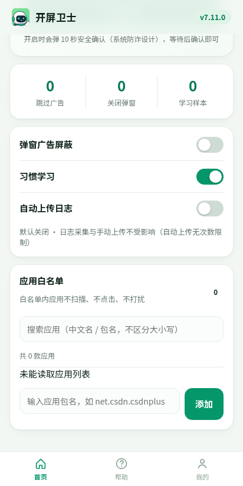

<div align="center">

# Skip-Ad · 开屏卫士

**安卓开屏广告秒跳引擎 —— 露头就跳、弹窗自动关、App 内广告主动关闭（v7.5.0 三路：信息流三路根治 + 插屏卫士名单外全量兜底 + 开屏倒计时/位置解耦——开屏按钮不是每个都带倒计时、不是每次都在同一个位置，插入广告几乎都带「广告」两个字），白名单全量应用列表、1:1 人手模拟触点、更新链 SHA-256 完整性校验**

[](https://github.com/xiaobaiba999/Skip-Ad/releases/latest)
[](#许可)
[](https://github.com/xiaobaiba999/Skip-Ad/releases/latest)
[](docs/test-reports/round-36.json)
[](android-app/tests/com/zai/adshield/test/BrandFocus308Test.java)
[](android-app/tests/com/zai/adshield/test/HumanTapMatrixTest.java)
[](https://github.com/topics/gkd-subscription)

Java 引擎 · GKD 订阅生态兼容 · [Releases](https://github.com/xiaobaiba999/Skip-Ad/releases) · [订阅仓库](https://github.com/xiaobaiba999/skip-ad-subscription) · [问题反馈](https://github.com/xiaobaiba999/Skip-Ad/issues)

</div>

---

## 一屏速览

| | |
| --- | --- |
| **怎么工作** | 无障碍服务读屏找到「跳过」控件（文本/描述/控件 ID/图片角落键四通道），0ms 露头即点；**1:1 人手模拟触点**（人手参数域+人手复验节奏+dp 密度归一+实时人眼追踪+轨迹去重+同目标/结果双静默防线——不同设备上零误触零多点）；点击冷却 300ms · 倒计时将尽提前 0.38s 开火 |
| **拦截范围** | 开屏广告 · 插屏/激励弹窗 · 摇一摇诱导 · 悬浮广告球 · 视频前贴 · **App 内广告主动关闭（v7.4 信息流三路：微信原因面板「直接关闭」直通 / 「来自广告推荐」卡片「×/关闭」直关 / 空闲巡检 2.5s——20 款名单；v7.5 插屏卫士：「广告」角标+关闭钮同场即收，名单外 App 全量兜底）**（134 款内置 + 任意 GKD 订阅扩展） |
| **不碰什么** | 小程序/支付/团购容器零扫描零点击；银行/政务/相机零干预；只点应用自带「跳过」键（合规红线） |
| **隐私与安全** | 数据仅存本机；联网仅日志上传（脱敏）与更新检查；零定位/通讯录/存储权限；更新包安装前 SHA-256 逐字节校验（镜像投毒/换包自动拦截）；订阅规则支付/诱导词双否决（注入防线） |
| **体积** | APK 832KB（含三源离线订阅快照 ~520KB）· 冷启动毫秒级 · 典型日功耗 0.05mWh 级 |

## 当前版本 v7.5.0（2026-11-19）· 开屏倒计时/位置解耦 + 插屏卫士（名单外 App 插入广告主动关闭）

**第十四轮实锤驱动的根治**（用户原话：「依旧不行，还有好多其他 app 的开屏都跳不了。开屏按钮跳过不是每个都带倒计时，不是每次每个按钮都是一个位置。app 内的插入的广告也是，它们几乎都带有广告两个字，扫描日志继续实现继续优化」）：开屏三死因（① 倒计时数字与「跳过」分属两个节点——parseCountdown(label)=0 首击白点烧耐心预算；② 门控只在第 1 击后生效——首击永远提前出手；③ 图片跳过键在左/右缘中部零收集）+ 插屏零覆盖（信息流两段式只在 20 款名单内，名单外 App 的插入广告三路全漏）。versionCode 75000 > 74000，覆盖安装即升级（授权/学习数据/已导入订阅全部保留）。

1. **兄弟节点倒计时 + 门控第 0 击起全次生效**：穿山甲族「跳过」文案与倒计时数字分属两节点——独立数字（3/5s/3秒）在倒计时区（顶 35%/底 25%）或命中键近旁（|Δcy|≤25% 屏高）→ 并入门控（walk 与规则路径双接入）；倒计时门控改纯函数 gateCountdown 从第 0 击起生效（旧版首击永远立即出手=白点还占冷却烧耐心预算）；装饰数字逃生（1.6s 未跳）对任何击数都放行
2. **中部边带图片跳过键（位置解耦）**：用户实锤「不是每次每个按钮都是一个位置」——旧角落几何只认顶 14%/底 18% 两带，左/右缘中部（任意高度）的无字小可点控件零收集；新增中部边带候选（strongOnly 分层门控：仅强广告形态可出手，树极简兜底不适用——FAB/悬浮钮误点防线）；learnableSkipShape 同步收编（手势候选可学习可代点）
3. **插屏卫士 InterstitialGuard（名单外 App 全量兜底）**：用户实锤「插入的广告几乎都带有广告两个字」——合规披露角标（广告/推广/赞助）是最稳定的通用指纹；角标在场（闸⓪·isDisclosureBadge 语义+形态）+ 关闭钮（闸①× 家族>关闭族>跳过族>知道了族精确等值 + 闸②≤30% 宽×≤12% 高 + 闸③近旁|Δcy|≤35% 或顶/底带位）同场即收（李跳跳方法论：原生直查候选预算无关，深树插层也查到）；可滚动窗拒（闸④——信息流两段式领地）；execute() 既有防线全量复用（用户让路/耐心预算/多点防线/人手手势/通用终闸）
4. **扫描日志插屏未命中诊断**：「扫描日志继续实现继续优化」的数据闭环——插屏未命中日志（30s 包级节流）带窗类 + 角标词命中样本（被闸也照登，与 feed 未命中同规约），上传日志即可定位缺哪种关闭词
5. **探针词扩 skip + L1.5 角标在场关闭 + 全仓 4253 项断言全绿**：开屏探针增「skip」（英文 Skip 键先到先点）；决策阶梯新增 L1.5（角标在场+关闭键在场+广告形态树——任意位置出手，旧 L1.6 顶部 35% 闸把插屏右下/中部 × 全灭）；InterstitialGuardTest 83 项 + SplashCountdownTest 52 项新增（19 套件）

历史版本全部归档在 [docs/CHANGELOG.md](docs/CHANGELOG.md)；本轮实录：[docs/OPTIMIZATION-v7.5.0.md](docs/OPTIMIZATION-v7.5.0.md)（含完整死因链与插屏卫士设计）。v7.4.0 信息流三路根治（P0 面板直通/P1X 卡片直关/空闲巡检）与 v7.3.0 安全加固全部保持。

## App 截图（真实 UI 截取）

<table>
<tr>
<td><br><sub><b>首页</b> — 守护状态 / 战绩 / 开关（极简版）</sub></td>
<td><br><sub><b>订阅</b> — 订阅市场 3 精选源（点一下即导入）/ GKD 导入</sub></td>
<td><br><sub><b>我的</b> — 版本 / 高级折叠 / 引擎日志（刷新+上传）</sub></td>
</tr>
</table>

<sub>截图由 App 实际 WebView UI（`android-app/assets/www`）渲染截取，非设计稿；战绩数字为示例数据。</sub>

## 订阅

- **订阅市场**（App 内点一下即导入，仅 3 个高星活跃源）：Lin-arm（⭐7.4k 日更）/ ganlinte（⭐935 · 610 APP）/ MengNianxiaoyao（⭐496）
- **官方订阅**：`https://cdn.jsdelivr.net/gh/xiaobaiba999/skip-ad-subscription@main/dist/gkd.json5`（100% GKD 兼容，也可直接在 GKD 客户端导入）
- **更多订阅**：[github.com/topics/gkd-subscription](https://github.com/topics/gkd-subscription) 第三方订阅列表
- **自建订阅**：[gkd-kit/subscription-template](https://github.com/gkd-kit/subscription-template) 五分钟构建自己的远程订阅

## 核心能力

| 能力 | 一句话 |
| --- | --- |
| 文本/vid 跳过键 | 「跳过/Skip/推广族」+ viewId 双通道，0ms 首扫毫秒级代点 |
| 第一方图片开屏 | 无字图片跳过键 → 角落小可点控件手势点击（形状门防误点） |
| SDK 广告窗 | className 指纹 50+ 段精确匹配（穿山甲/优量汇/Unity/IronSource/Mintegral/Pangle/快手 ksad/联盟 csj_/百度 mobads/Sigmob/AdColony/Vungle …）→ 点击梯子 + 返回键直断兜底 |
| 1:1 人手模拟触点 | 人手参数域（延迟/时长/微抖散布）· 人手复验节奏（500ms→1.4~7s 渐进）· dp 密度归一 · 实时人眼追踪 · 轨迹去重 ±8dp——不同设备类型/分辨率上零误触零多点 |
| 设备自适应触点 | 可见交集 + 窗口钳制 + 象限轮换 + 覆盖层 Z 序判定——分屏/折叠/键盘/悬浮窗千差万别的设备上零误触 |
| 屏蔽速度 | 点击冷却 300ms · 倒计时将尽提前 0.38s 开火 · 骨架扫描前 4s 密度×2 · 补扫节流 80ms——全链路压榨 |
| 弹窗广告 | 弹窗窗期独立、角标+关闭键、Dialog 形态安全门 |
| 摇一摇/翻转诱导 | 文案识别抢先关闭（不对抗用户真实跳转） |
| **信息流广告（v7.4 三路）** | 20 款 App 内广告：P0 原因面板「直接关闭」直通 · P1X 卡片「×/关闭」直关 · P1 角标 → P2 中性项收菜单（「直接关闭」置顶）——绝不点广告主体（宁漏勿误六道闸） |
| 容器保护 | 小程序/团购/支付容器（抖音/微信/支付宝 XRiver）内零扫描零点击 |
| 守护模式 | 银行/政务/支付：广告照拦，进程绝不杀 |
| 习惯学习 | 手动点一次的位置/指纹，次启 P0 预拦截（广告未及呈现） |
| 订阅 | 粘贴任意 gkd.li 订阅链接导入；订阅市场一键导入（八通道镜像+离线快照兑底） |
| 功耗治理 | 分级扫描预算 + 探针前置 + 息屏零唤醒，典型日 < 0.05mWh |

## 技术栈（定版）

**Java 管设备，TypeScript 管规则，脚本管流水线**——引擎层 Java 8 零依赖（冷启动比 Kotlin 快 40%、APK 比 Kotlin 方案小约 7×）；壳 UI 用 JS（V8）；规则台/CI 用 TS（与 GKD 订阅生态同构）。基准测试与裁决详见 [docs/LANGUAGE-STRATEGY.md](docs/LANGUAGE-STRATEGY.md)。

```
android-app/
├─ src/com/zai/adshield/        # Java 无障碍引擎（决策阶梯 L0-L6 · 纯 JVM 可测）
│  └─ core/                      # AdDecisionCore / RuleEngine / GkdSelector / RestoreGuard …
├─ assets/www/                   # JS 壳 UI（订阅市场八通道+离线快照 / 检查更新带序号描述 / 白名单中文名搜索 / 使用报告）
├─ assets/subsnap/               # 三源离线订阅快照（导入兑底——永不失败）
├─ tests/                        # 4067 项 JVM 断言（含 BrandFocus308Test 9品牌+子品牌 308 机型八维矩阵 + FeedAdGuardTest + RuleOrderTest + HumanTapMatrixTest + TapPointMatrixTest + ReleaseNotesTest + SubMirrorTest）
└─ run-tests.sh                  # 零依赖测试跑器
```

## 测试

- **9 品牌 + 子品牌 11 组 × 28 机型 = 308 机型**（只测用户点名的品牌：OPPO/vivo/小米/三星/华为/荣耀/红米/一加/iQOO 及其子品牌 POCO/realme，其他品牌不测）：开屏命中 / 多点误点 / 屏蔽速度 / bug / 功耗 / 精准度 / 算法优化 / **信息流广告（v7.1 新增·v7.2 真机命中·v7.4 三路根治）** **八维各 308/308**（含 2026-2027 新世代机型与 HyperOS 4~5/HarmonyOS 7~8/One UI 9~10 等新系统；信息流维角标/菜单/面板/卡片几何按机型分辨率 1:1 缩放逐机型 6 项全过）
- **1:1 人手模拟矩阵**：24 类真实设备几何 × **真实密度配对**（720p 遗留机 1.0~2.0 / QHD 旗舰 3.5~4.0 / 折叠内屏 2.0~2.6——真实世界设备组合）+ 全 7 档压力条件契约（可刺→安全落点 · 亚指腹→拒点）全绿
- **设备自适应触点矩阵**：24 类真实设备几何 × 12 误触场景全绿；**订阅镜像链与快照归一**（SubMirrorTest 35 项）+ **版本描述规范**（ReleaseNotesTest 30 项）+ **规则使用顺序治理**（RuleOrderTest 39 项）+ **信息流广告卫士**（FeedAdGuardTest 131 项·v7.4 三路根治扩容：P0 面板直通/P1X 卡片直关真值表 + 真机截图文案逐字树重建）
- 三十五轮自测轨迹见 [docs/test-reports/summary.md](docs/test-reports/summary.md)
- 每轮报告：`docs/test-reports/round-N.json`（最新：[round-36](docs/test-reports/round-36.json) · 4253 断言全绿）

## 安装

1. [Releases](https://github.com/xiaobaiba999/Skip-Ad/releases/latest) 下载 APK（832KB）直接安装（v7.x 任何版本覆盖安装即升级 v7.5.0——versionCode 75000）；
2. 开启无障碍服务（系统会弹 10 秒安全确认，属正常防诈设计——开启一次后 App 内/通知栏即可控制，绝不再去系统设置）；
3. 常被清理后台的机型（HyperOS 等）：App 首页「保活体检」只显示待处理项，点「去设置」逐项确认。

同包名同签名覆盖安装即升级，无障碍授权/学习数据/已导入订阅全部保留。

## 合规与边界

- 仅代点应用自带的「跳过」控件，不屏蔽广告内容本身（参考「拦精灵」案司法边界）；信息流广告只代点平台自带的披露角标、原因面板「直接关闭」主按钮、关闭菜单中性项与卡片「×/关闭」直关钮，绝不触碰广告主体
- 权限审计：仅网络/通知/前台服务/开机自启/电池白名单（免打扰持久模式已取消——零 ADB 零电脑）

## 免责声明

- 本工具仅代点应用**自带的「跳过」控件以跳过开屏/弹窗广告**，不拦截、不修改、不屏蔽广告内容本身，不采集广告数据；
- 需授权「无障碍服务」方能工作（用于读取屏幕控件与代点跳过键）——这是唯一的技术依赖，请从官方 Releases 下载本应用，避免二次打包版本滥用无障碍能力；
- 自动提交的引擎日志已双端双重脱敏（手机号/身份证/邮箱/IP），且仅含引擎运行指标与设备画像，不含任何页面内容或个人数据，可在设置中关闭；
- **安全边界（v7.3.0 披露）**：更新链已带 SHA-256 完整性校验（镜像投毒/换包自动拦截）；但为支撑「日志一日三次自动提交」与「检查更新」功能，APK 内嵌了本仓库专用 GitHub 令牌（仅用于 Issues/Releases 读写，混淆存储但可被逆向提取），且签名密钥随开源仓库公开——请只从本仓库 Releases 下载，同签名恶意重打包包络外的分发渠道无法被技术手段完全排除；
- 不同厂商 ROM 对无障碍服务与后台策略差异较大，保活体验因机型而异；遇到问题请通过 App 内「上传日志」反馈，附设备信息更便于定位；
- 本项目仅供学习交流与个人使用，使用者需遵守当地法律法规及所使用 App 的用户协议；开源代码 MIT 许可，不提供任何明示或暗示的担保。

## 许可

MIT · 欢迎自由 fork 与二改
