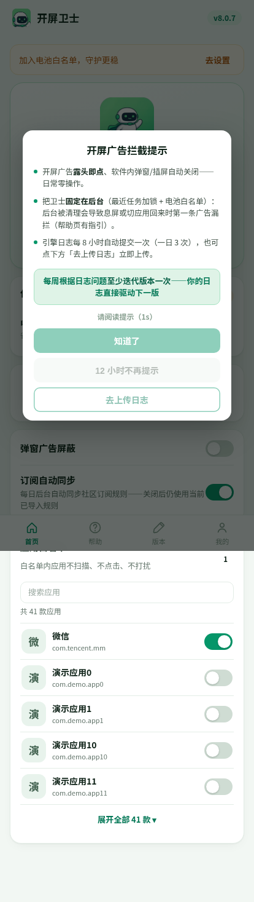
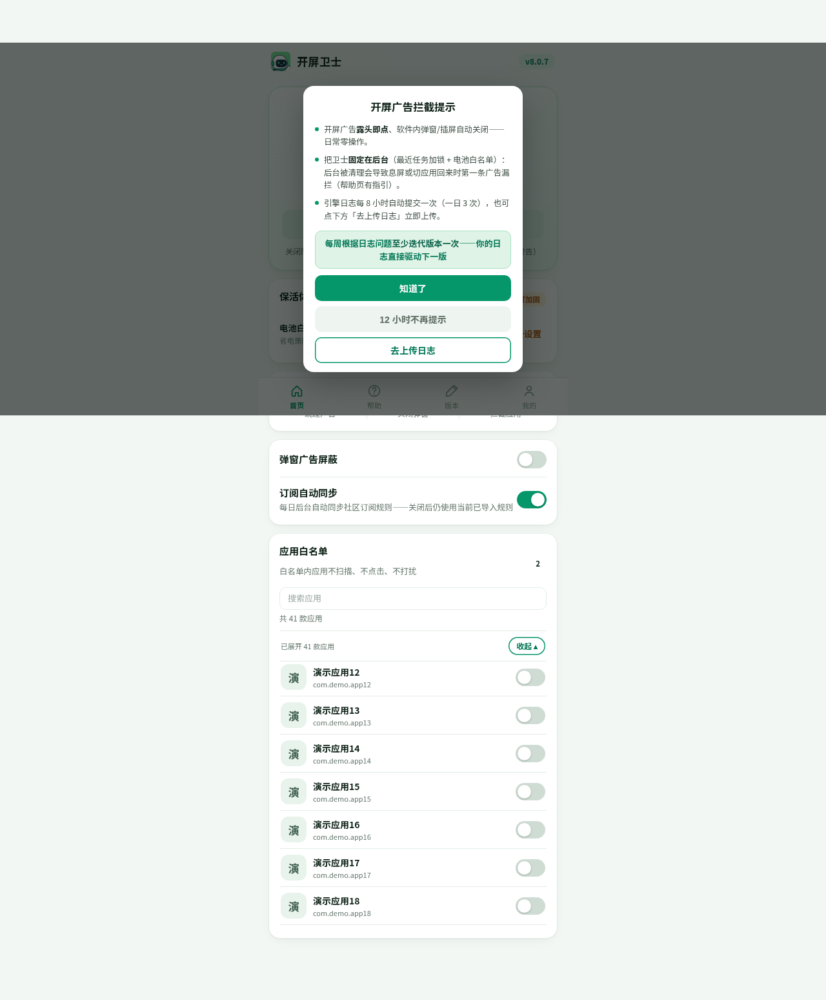
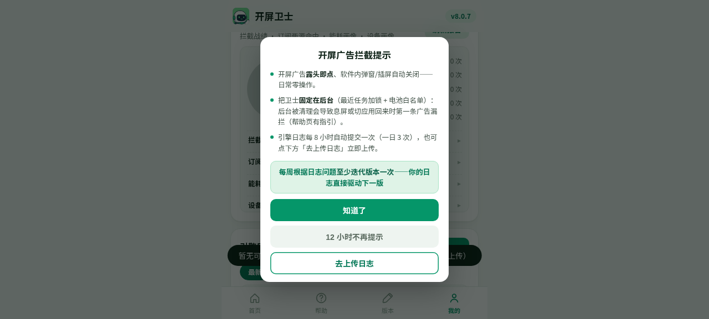
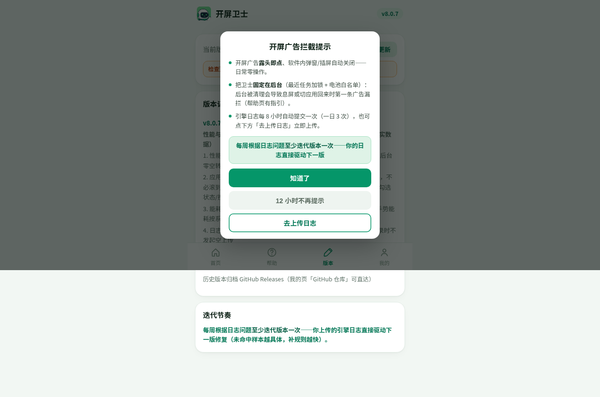
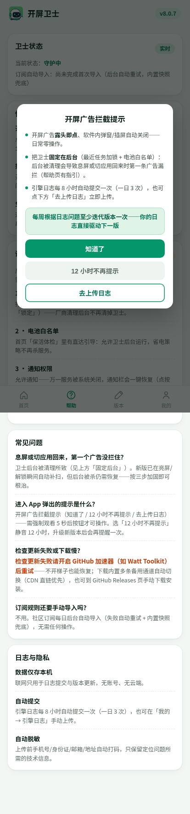

<div align="center">


# 开屏卫士 · Skip-Ad

**新一代安卓广告跳过工具 —— GKD 内核 × 开屏卫士产品层，融合重写**

在开源项目 [GKD](https://github.com/gkd-kit/gkd)（GPL-3.0，本项目基线为上游 1.13.2）核心技术基础上重构、融合与产品化开发：开屏 · 弹窗 · 信息流 · 反馈面板，无障碍事件驱动匹配，只点应用自带的「跳过 / 关闭」键。

[](#%EF%B8%8F-%E4%B8%8B%E8%BD%BD%E4%B8%8E%E5%AE%89%E8%A3%85)
[](https://github.com/xiaobaiba999/Skip-Ad/releases/latest)
[](#%EF%B8%8F-%E4%B8%8B%E8%BD%BD%E4%B8%8E%E5%AE%89%E8%A3%85)
[](#%EF%B8%8F-%E4%B8%8B%E8%BD%BD%E4%B8%8E%E5%AE%89%E8%A3%85)
[](#-%E5%BC%80%E6%BA%90%E5%8D%8F%E8%AE%AE%E5%8F%8A%E8%87%B4%E8%B0%A2)

[Releases](https://github.com/xiaobaiba999/Skip-Ad/releases) · [更新日志](docs/CHANGELOG.md) · [安全披露](docs/SECURITY.md) · [问题反馈](https://github.com/xiaobaiba999/Skip-Ad/issues)

</div>

---

## 📖 项目简介

开屏卫士 Skip-Ad 是在 GKD 项目（[github.com/gkd-kit/gkd](https://github.com/gkd-kit/gkd)，GPL-3.0，本项目基线为上游 1.13.2）核心技术基础上进行重构、融合与产品化开发的新一代安卓广告跳过工具。**8.x 系列 = GKD 内核**（选择器引擎 / 规则匹配 / 无障碍服务 / 订阅体系，GPL-3.0 原样保留）**× 开屏卫士 7.15.x 产品层**（WebView UI + AndroidApp 桥 + 使用报告 / 白名单 / 日志上传）融合重写。

| | |
| --- | --- |
| **怎么工作** | 无障碍服务读取屏幕节点，GKD 选择器内核按订阅规则匹配，代点应用**自带的「跳过 / 关闭」键**；无障碍事件驱动，组级规则懒编译，无规则应用早退 |
| **拦什么** | 开屏广告 · 弹窗 · 信息流 · 反馈（评价）面板——规则全部来自 GKD 社区订阅生态 |
| **开箱即用** | 内嵌三订阅（Lin-arm / aoguai / 甘霖），全新安装即生效，每日自动同步，离线快照兜底 |
| **隐私** | 数据仅存本机；联网仅日志上传（双层脱敏、可关）与更新检查；更新包 SHA-256 + 大小双校验 |
| **体积** | APK 3.5MB · Android 8.0+ · 签名证书与 v7.x 全系一致（直接覆盖升级） |

## 🧬 新一代版本说明（8.x 与 7.x 的区别）

| | 7.x 系列（历史） | 8.x 系列（当前主线） |
| --- | --- | --- |
| **引擎** | 纯 Java 自研引擎（内置规则表 + 多通道识别） | GKD 内核（选择器引擎 / 规则匹配 / 无障碍服务 / 订阅体系，GPL-3.0 原样保留） |
| **规则生态** | 内置规则表 + GKD 订阅格式兼容导入 | GKD 社区订阅体系原生，内嵌三订阅开箱即用，每日自动同步 |
| **产品层** | WebView 壳 UI | 7.15.14 UI 基座融合重写：WebView UI + AndroidApp 桥 + 使用报告 / 白名单 / 日志上传 |
| **日志与诊断** | 单通道日志 | 双通道引擎日志（最新 + 详细）+ GitHub Issues 上传（双层脱敏） |
| **开源协议** | MIT | **GPL-3.0**（因含 GKD 内核——法律要求，见[开源协议及致谢](#-开源协议及致谢)） |
| **源码位置** | `android-app/`（历史保留） | `skip-ad-v8/` |

> 8.x 不是「换皮 GKD」，也绝不宣称全部原创：**内核能力来自 GKD**（基线为上游 1.13.2），**产品层为本项目融合开发**——来源边界见 [GKD 基础与重构说明](#-gkd-基础与重构说明)。7.x 历史版本明细见 [docs/CHANGELOG.md](docs/CHANGELOG.md)。

## ⚙️ 核心功能

| 能力 | 说明 |
| --- | --- |
| 广告跳过引擎 | GKD 选择器内核 + 社区订阅规则（开屏 / 弹窗 / 信息流 / 反馈面板）；无障碍事件驱动匹配，组级规则懒编译，无规则应用早退 |
| 内嵌三订阅 | Lin-arm / aoguai / 甘霖三套社区订阅随 APK 内嵌，开箱即用；每日自动同步，离线快照兜底（订阅作者归属在 `assets/subscriptions` 内保留） |
| 应用白名单 | 真实应用名称 / 图标（WebP）/ 搜索；默认折叠 5 款预览，展开全部 + 置顶收起条（v8.0.7）；勾选与滚动状态保持 |
| 卫士使用报告 | 拦截战绩累计 / 订阅两源命中 / 能耗画像（无障碍事件 / 规则扫描为真实计数，手势能耗为系数估算并明确标注）/ 设备画像 / 应用战绩 Top5 |
| 引擎日志双通道 | 「最新」简洁触发记录 +「详细」全链路（服务连接 / 断开 / 动作执行与失败及实测耗时 / 匹配未命中汇总 / 无规则应用 / 订阅状态与更新失败 / 配置变更 / 事件处理异常）；数据库持久化（500 / 1200 条上限），异步批量写入不阻塞无障碍线程，动作与详细记录同事务关联（v8.0.8 恢复并超越 7.15.14 详细日志能力） |
| 日志上传 GitHub Issues | 手动 + 自动（8h 节流 / 亮屏才传 / 无新内容不建空 Issue / 成功才计时）三通道统一报告（自动 / Compose 手动 / WebView 手动同一构建器同一口径）；双层脱敏（手机号 / 身份证 / 邮箱 / IPv4）+ 15s 频控；上传失败保留本地可重试 |
| 版本更新 | 多源检查（jsDelivr → gcore → raw + 历史 kilo 回退）；SHA-256 + 大小双校验；下载域白名单；旧版 v7.15.x / v7.x / 8.0.x 全兼容发现 |
| 性能与功耗设计 | 日志写入全异步化（有界队列 256 / 批 16）、内存缓存全有界（节点 LRU 4096 / 图标 LRU 160）、WebView 后台暂停 / 查询 LIMIT 下推 / 事件编码移出事件线程（v8.0.7） |
| 稳定性与安全（v8.0.8） | 汽水音乐开屏误触根治（订阅补丁层：无锚点结构分支删除 / 穿山甲跳过键 id 兜底 / 全局组跨源排除，跨每日订阅同步持久生效）；坐标点击前目标可见性校验（陈旧节点宁可失败不误点）；启动黑屏根治（三色连续：系统启动窗 / 首帧 / WebView）；液态柔光玻璃触发提示（Logo + 正在守护）；异常兜底七项（主线程 ANR / DB 损坏自愈 / 事件循环异常隔离 / 手势回调超时 / 网络超时 / WebView 加载失败兜底 / 崩溃提醒不丢） |

## 🏗️ 技术架构

**内核管匹配，产品层管体验**——8.x = GKD 内核（GPL-3.0）× 开屏卫士产品层融合重写：

```
开屏卫士 v8.x（skip-ad-v8/）
│
├─ 内核层 —— 来自 GKD（github.com/gkd-kit/gkd，基线上游 1.13.2，GPL-3.0 原样保留）
│   ├─ 无障碍服务      事件驱动 · 屏幕节点快照 · 点击 / 手势动作执行
│   ├─ 选择器引擎      快照选择器语法解析与节点匹配
│   ├─ 规则匹配        订阅规则调度 · 组级懒编译 · 无规则应用早退
│   └─ 订阅体系        订阅拉取 · 解析 · 缓存 · 规则导入
│
├─ 产品层 —— 开屏卫士 7.15.x 融合重写（本项目开发）
│   ├─ WebView UI      首页 / 应用白名单 / 使用报告 / 引擎日志 / 版本 / 帮助
│   ├─ AndroidApp 桥   WebView ↔ 无障碍服务 / 数据库 / 系统 API
│   ├─ 卫士使用报告    拦截战绩 / 订阅两源命中 / 能耗画像 / 设备画像 / 应用 Top5
│   ├─ 引擎日志        双通道（最新 + 详细）· 数据库持久化 · 异步批量写入
│   └─ 日志上传 / 更新 GitHub Issues 上传（双层脱敏）· 多源更新检查（SHA-256 双校验）
│
└─ assets/subscriptions —— 内嵌三订阅（Lin-arm / aoguai / 甘霖，作者归属保留）
```

**验证状态（如实标注）**：

| 验证项 | 方式 | 结论 |
| --- | --- | --- |
| 单元测试 · gkd-db | JVM / host | 全绿 |
| 单元测试 · gkd-app host | JVM / host | 98 测试 1 预存失败（A11yWindowReadTest——v8.0.6 基线同样失败） |
| 单元测试 · gkd-app jvm | JVM | 459 测试 2 预存失败类（快照分享断言 + MatchNodeReader 并发时序——均在 v8.0.6 基线复现） |
| WebView UI | 浏览器实测 | 白名单展开 / 收起 / 勾选保持 / 滚动保持 9/9 通过；上传无内容门正确；0 控制台错误 |
| 日志上传 | E2E（真实 Issue） | 真实创建 GitHub Issue [#139](https://github.com/xiaobaiba999/Skip-Ad/issues/139) 并 GET 复验（标题一致 / open 状态） |
| 更新兼容 | 旧版客户端逻辑复刻 | 发布链验证（发布后执行） |
| 真机设备测试 | — | **NOT_RUN**（本环境无真机；小米 15 Pro / Redmi / 一加等真机数据本版未采集） |

> 预存失败均与本版改动无关，已用 v8.0.6 基线对照验证；真机 CPU / 内存 / 功耗数据未采集，本文不做任何真机性能结论。

## 🧩 GKD 基础与重构说明

**哪些来自 GKD**（[github.com/gkd-kit/gkd](https://github.com/gkd-kit/gkd)，GPL-3.0，本项目基线为上游 1.13.2，原样保留）：

- 选择器引擎（快照选择器语法解析与匹配）
- 规则匹配（订阅规则调度、组级懒编译）
- 无障碍服务（事件驱动、屏幕节点快照、点击 / 手势动作）
- 订阅体系（订阅拉取、解析、缓存、规则导入）

**哪些是本项目融合开发**：

- WebView UI（首页 / 应用白名单 / 使用报告 / 引擎日志 / 版本 / 帮助）
- AndroidApp 桥（WebView ↔ 无障碍服务 / 数据库 / 系统 API）
- 应用白名单（真实应用名称 / 图标 / 搜索 / 折叠展开交互）
- 卫士使用报告（拦截战绩 / 订阅两源命中 / 能耗画像 / 设备画像 / Top5）
- 引擎日志双通道 + 日志上传 GitHub Issues（双层脱敏）
- 版本更新链（多源检查、SHA-256 + 大小双校验、下载域白名单）

**GPL-3.0 义务履行**：8.x 源码完整开源在仓库 `skip-ad-v8/` 目录，GPL-3.0 许可证文件与 GKD 来源声明保留，本 README 与 CHANGELOG 明确标注来源与边界。任何对本项目的分发同样适用 GPL-3.0。

## 📱 UI 展示截图

<table>
<tr>
<td><br><sub><b>首页</b> — 守护状态 / 战绩 / 应用白名单入口</sub></td>
<td><br><sub><b>应用白名单</b> — 真实名称 / 图标 / 搜索 / 展开全部 + 置顶收起条</sub></td>
<td><br><sub><b>卫士使用报告</b> — 拦截战绩 / 订阅命中 / 能耗画像 / 应用 Top5</sub></td>
</tr>
<tr>
<td><br><sub><b>版本</b> — 检查更新 / 版本记录</sub></td>
<td><br><sub><b>帮助</b> — 快速上手 / 常见问题</sub></td>
</tr>
</table>

<sub>截图为 App WebView UI 实际渲染（浏览器环境实测采集），页面数字为当时会话示例。</sub>

## 🔗 规则和订阅说明

- **内嵌三订阅，开箱即用**：Lin-arm / aoguai / 甘霖三套 GKD 社区订阅随 APK 内嵌，全新安装无需任何手动导入即生效；每日自动同步保持最新，网络不可用时离线快照兜底；订阅作者归属在 `assets/subscriptions` 内保留；
- **覆盖场景**：开屏广告 · 弹窗 · 信息流 · 反馈（评价）面板——规则由 GKD 社区订阅生态持续维护；
- **与 GKD 生态同构**：订阅体系即 GKD 社区订阅体系，社区新增规则随每日同步自动跟进。

## 📊 卫士使用报告

- **拦截战绩累计**：广告拦截战绩长期累计；
- **订阅两源命中**：命中按订阅来源分列统计（两源口径）；
- **能耗画像**：无障碍事件 / 规则扫描为**真实计数**；手势能耗为**系数估算并在页面明确标注**——绝不拿估算冒充实测；
- **设备画像**：本机设备与系统信息画像；
- **应用战绩 Top5**：拦截战绩最多的前 5 款应用。

## 🩺 引擎日志和诊断

**双通道引擎日志**（v8.0.8 恢复并超越 7.15.14 详细日志能力）：

- **最新（简洁通道）**：每轮触发的简洁记录（命中 / 出手等关键事件）；
- **详细（全链路通道）**：服务连接 / 断开、动作执行与失败（含规则名与实测耗时）、**匹配未命中汇总**（按应用 8 秒窗口聚合：未命中分布与涉及规则组——直接回答「广告为什么没跳过」）、无规则应用、订阅状态与更新失败、配置变更、事件处理异常；
- 数据库持久化（最新 500 / 详细 1200 条上限），动作与详细记录同事务关联（actionLogId 可串起一次处理链路）；
- 异步批量写入（有界队列，不阻塞无障碍线程；高频事件按应用窗口聚合，动作成败等关键结果绝不采样）。

**日志上传 GitHub Issues**：

- **三通道统一报告**（v8.0.8）：自动上传、Compose 手动上传、WebView 手动上传使用同一构建器同一口径，六节结构（基本环境 / 最新触发记录 / 详细执行记录 / 异常与失败 / 统计摘要 / 日志说明），标题带设备信息与版本；
- 手动 + 自动（8h 节流 / 亮屏才传 / 无新内容不建空 Issue / 成功才计时）+ 15s 客户端频控；
- **双层脱敏**：手机号 / 身份证 / 邮箱 / IPv4 上传前双重清洗（发布链真实 Issue E2E 实证）；
- 上传失败保留本地，可重试；
- 上传链已用真实 Issue 验证：仓库 Issues 存档 E2E 验证 [#139](https://github.com/xiaobaiba999/Skip-Ad/issues/139)（创建后 GET 复验，标题一致 / open 状态）。

## 🔋 性能与功耗设计

> 本版无真机 CPU / 内存 / 功耗实测数据，以下为**设计机制**描述，不做任何性能数字承诺。

- **日志写入全异步化**：全部日志写入走有界队列（容量 256、批量 16）异步批量落库，绝不阻塞无障碍事件线程；
- **内存缓存全有界**：节点缓存 LRU 4096 / 图标缓存 LRU 160，内存占用有上界；
- **WebView 后台暂停**（v8.0.7）：App 退后台时暂停 WebView，回前台恢复；
- **查询 LIMIT 下推**（v8.0.7）：数据查询在源头限行，避免整表拉取；
- **事件编码移出事件线程**（v8.0.7）：无障碍事件的编码工作从事件线程剥离，事件线程更轻；
- **无规则应用早退 + 组级规则懒编译**（GKD 内核）：无关应用零开销跳过，规则首次用到才编译。

## ⬇️ 下载与安装

**当前版本 [v8.0.8](https://github.com/xiaobaiba999/Skip-Ad/releases/tag/v8.0.8)（2026-11-27）** · versionName 8.0.8 · versionCode 88000 · APK `adshield-v8.0.8.apk` · 3577247 字节

| 下载通道 | 说明 | 链接 |
| --- | --- | --- |
| **GitHub Releases** | 官方主源（Release 资产） | [下载 adshield-v8.0.8.apk](https://github.com/xiaobaiba999/Skip-Ad/releases/download/v8.0.8/adshield-v8.0.8.apk) |
| **ghfast.top 镜像** | GitHub Release 资产加速 | [下载 adshield-v8.0.8.apk](https://ghfast.top/https://github.com/xiaobaiba999/Skip-Ad/releases/download/v8.0.8/adshield-v8.0.8.apk) |
| **jsDelivr CDN 直链** | 国内推荐，直出仓库归档（与 Release 资产同字节） | [gcore 直链](https://gcore.jsdelivr.net/gh/xiaobaiba999/Skip-Ad@main/android-app/dist/adshield-v8.0.8.apk) · [testingcf 备用](https://testingcf.jsdelivr.net/gh/xiaobaiba999/Skip-Ad@main/android-app/dist/adshield-v8.0.8.apk) |

- **完整 SHA-256**：`2e39c9962de66c77d6fe5db820ad4d270c61871c8882e15d9d8050e706c85bda`
- **签名证书 SHA-256**：`05ada6e3f7a4fc6bf77449611c24f51e1ef4caa0a91a5cdd02c4d877738e6f79`（与 v7.x 全系及 v8.0.4-8.0.6 一致）
- **升级**：已装 v7.x（v7.15.x）/ 8.0.x 任何版本——**直接覆盖安装即升级**（versionCode 88000 大于旧版全部，签名一致，无障碍授权与数据保留）；
- **全新安装**：下载 → 允许「安装未知应用」→ 安装 → 首页开启无障碍服务；内嵌三订阅开箱即用，无需手动导入规则；
- **系统要求**：Android 8.0+（minSdk 26）；
- 任一通道下载的 APK 与 Release 资产**同字节、同 SHA-256**，App 更新链安装前会自动做 SHA-256 + 大小双校验。

> **应用内「检查更新」失败？** 不用等——直接用上表任一直链在浏览器下载后覆盖安装即可（详见 [常见问题](#-常见问题)）。

## 🔄 更新方式

App 内「版本页 → 检查更新」：

- **更新清单**：[`update/latest.json`](update/latest.json)（GitHub raw 与 jsDelivr 四域同源）；
- **多源检查**：jsDelivr → gcore → raw 依次回退，另保留历史 kilo 域回退兼容；
- **双校验**：下载完成先验 SHA-256 + 文件大小，校验通过才进入安装；下载域白名单外的链接一律拒绝；
- **旧版全兼容发现**：旧版 v7.15.x 存量 versionCode 85000-86400 只按数值比较——88000 抬码保证 v7.15.x / v7.x / 8.0.x 全部能发现并覆盖升级（签名一致，无障碍授权与数据保留）；
- 更新兼容的旧版客户端逻辑复刻验证：**发布链验证**（发布后执行）；
- 应用内检查失败：直接用[下载区](#-下载与安装)任一直链浏览器下载后覆盖安装。

## ❓ 常见问题

<details open>
<summary><b>无障碍开关点了没反应 / 服务自动关闭？</b></summary>

系统弹出的 10 秒安全确认属正常防诈设计，等待后确认即可。无障碍服务被系统回收或厂商省电策略关闭时，按 App 内引导重新开启；常被杀后台的机型建议按下文「权限说明」开启电池白名单。
</details>

<details>
<summary><b>厂商杀后台，卫士经常失效？</b></summary>

HyperOS / ColorOS 等厂商 ROM 默认激进省电会回收无障碍服务。按 App 内引导开启电池白名单（厂商省电对抗）+ 通知保活提醒（服务被回收时提醒）；仍频繁失效时上传日志反馈。
</details>

<details>
<summary><b>为什么 versionCode 从 7.x 的 85000-86400 跳到 87100 再到 88000？</b></summary>

旧版 7.15.x 存量客户端比较版本只看 versionCode 数值。v8.0.7 显式抬码 87100（跨 7.15.x 存量段 85000-86400），8.0.8 延续抬码 88000——所有存量版本（v7.15.x / v7.x / 8.0.x）都能发现新版本并平滑覆盖升级——跳号是刻意的兼容设计，不是版本缺失。
</details>

<details>
<summary><b>日志在哪里看？</b></summary>

App 内「引擎日志」双通道：「最新」（简洁触发记录）+「详细」（服务连接 / 断开 / 动作执行与失败 / 订阅状态 / 配置变更全链路），数据库持久化（各 500 / 800 条上限）。可手动上传 GitHub Issues（双层脱敏）帮助定位问题。
</details>

<details>
<summary><b>应用内「检查更新」失败 / 提示多源不可达？</b></summary>

国内运营商对部分域名间歇不可达时应用内检查会失败。直接用[下载区](#-下载与安装)任一直链（CDN 直链国内通常畅通）下载后覆盖安装，或到 [Releases 页](https://github.com/xiaobaiba999/Skip-Ad/releases/latest)手动下载。
</details>

## 🔐 权限说明

| 权限 | 用途 | 必需性 |
| --- | --- | --- |
| **无障碍服务** | 读取屏幕节点定位「跳过 / 关闭」键并代点——核心引擎唯一技术依赖 | 核心必需 |
| **通知** | 保活提醒（服务被回收时提醒） | 可选 |
| **电池白名单** | 厂商省电策略对抗（App 内引导开启） | 可选引导 |

不申请定位 / 通讯录 / 短信等敏感权限；联网仅用于日志上传（可关闭）与更新检查。

## 🛡️ 隐私与安全

- **数据仅存本机**：拦截战绩 / 使用报告 / 引擎日志全部存于本机数据库；
- **联网仅两处**：日志上传 GitHub Issues（手动 + 自动，均先双层脱敏，可关闭）与版本更新检查——除此之外零联网；
- **双层脱敏**：手机号 / 身份证 / 邮箱 / IPv4 在上传前双重清洗；
- **更新链安全**：更新包 SHA-256 + 大小双校验、下载域白名单——换包 / 投毒自动拦截；
- **上传令牌机制与历史安全披露**：见 [docs/SECURITY.md](docs/SECURITY.md)（含 GitHub 令牌历史风险与整改备案）。

**使用边界与免责**：本工具仅代点应用**自带的「跳过 / 关闭」控件**，不拦截、不修改、不屏蔽广告内容本身，不采集广告数据；本项目仅供学习交流与个人使用，使用者需遵守当地法律法规及所使用 App 的用户协议（部分 App 用户协议限制自动化操作，账号风险由使用者自行评估）；广告是开发者的合法收入来源，请勿用于商业用途或批量分发；本项目不提供任何明示或暗示的担保。

## 📜 开源协议及致谢

**GPL-3.0**——8.x 系列包含来自 GKD 的内核代码（GPL-3.0），本项目整体以 GPL-3.0 分发（许可证文件随仓库保留）；对本项目的任何二次分发同样适用 GPL-3.0。

**致谢**：

- **[GKD](https://github.com/gkd-kit/gkd)** 及其上游作者——8.x 的选择器引擎 / 规则匹配 / 无障碍服务 / 订阅体系来自 GKD（本项目基线为上游 1.13.2），GPL-3.0 原样保留；
- **内嵌订阅作者**——Lin-arm / aoguai / 甘霖三套社区订阅（作者归属在 `assets/subscriptions` 内保留）；
- **7.x 历史贡献**——旧 7.x 系列（纯 Java 自研引擎）源码在仓库 `android-app/` 目录历史保留，8.x 产品层 UI 基座承自 v7.15.14。

**版本历史**：完整变更记录见 [docs/CHANGELOG.md](docs/CHANGELOG.md) 与 [Releases](https://github.com/xiaobaiba999/Skip-Ad/releases)。
