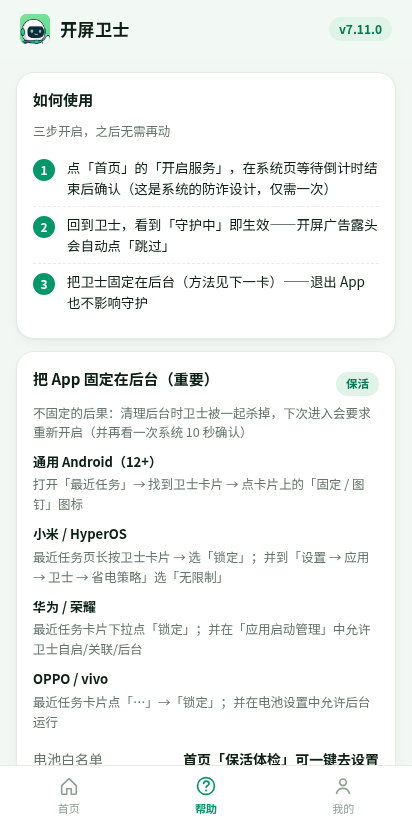

<div align="center">

# Skip-Ad · 开屏卫士

**安卓开屏广告秒跳引擎 —— 露头就跳（首击零门控）+ 广告任务状态机（v7.9.1：第一次成功后旧任务拒收一切点击/过期回调——重复点击·误触根治，第一次失败仍安全有限重试）+ 插屏卫士（语境三路并集+图标关闭钮路径）+ 订阅反饥饿与七分类统计 + 视频开屏卫士（静默画像归一 → 20s 观察窗/轮询针）、弹窗自动关、白名单全量应用列表、1:1 人手模拟触点 + 200+ 应用生态兼容性体系（v7.9.2：233 款应用目录 + L1/L2/L3 分层测试 + 引擎包名校准）**

[](https://github.com/xiaobaiba999/Skip-Ad/releases/latest)
[](#许可)
[](https://github.com/xiaobaiba999/Skip-Ad/releases/latest)
[](docs/CHANGELOG.md)
[](android-app/tests/com/zai/adshield/test/BrandFocus396Test.java)
[](android-app/tests/com/zai/adshield/test/HumanTapMatrixTest.java)
[](https://github.com/topics/gkd-subscription)

Java 引擎 · GKD 订阅生态兼容 · [Releases](https://github.com/xiaobaiba999/Skip-Ad/releases) · [订阅仓库](https://github.com/xiaobaiba999/skip-ad-subscription) · [问题反馈](https://github.com/xiaobaiba999/Skip-Ad/issues)

</div>

---

## 一屏速览

| | |
| --- | --- |
| **怎么工作** | 无障碍服务读屏找到「跳过」控件（文本/描述/控件 ID/图片角落键四通道），0ms 露头即点；**广告任务状态机（v7.9.1）**：每窗唯一任务 + 不可逆成功终态（第一次关掉后旧任务拒收一切点击——重复点击/误触根治）+ 第一次失败仍安全有限重试（重试前重新验广告/验候选/验安全闸）；视频开屏画像（零候选连环+树静默/零事件归一 → 观察窗 20s + 轮询针）；**1:1 人手模拟触点**；点击冷却 300ms · 倒计时将尽提前 0.38s 开火 |
| **拦截范围** | 开屏广告（含**视频开屏**——静默画像归一 v7.9.1）· 插屏/激励弹窗 · 摇一摇诱导 · 悬浮广告球 · 视频前贴 · **App 内广告主动关闭（信息流三路 20 款名单 + 插屏卫士：语境三路并集 + 图标关闭钮路径 + 订阅反饥饿 v7.9.1——远程 GKD 订阅重新参与匹配）**（134 款内置 + 自动订阅扩展：id667 每日后台导入覆盖 600+ 款）· **应用生态兼容性目录（v7.9.2：compatibility/apps_catalog.json 233 款常用应用——包名三层来源严格区分，12 分类配额，每轮迭代 L1 回归）** |
| **不碰什么** | 小程序/支付/团购容器零扫描零点击；银行/政务/相机零干预；只点应用自带「跳过」键（合规红线） |
| **隐私与安全** | 数据仅存本机；联网仅日志上传（脱敏）与更新检查；零定位/通讯录/存储权限；更新包安装前 SHA-256 逐字节校验（镜像投毒/换包自动拦截）；订阅规则支付/诱导词双否决（注入防线） |
| **体积** | APK 858KB（含三源离线订阅快照 ~520KB）· 冷启动毫秒级 · 典型日功耗 0.05mWh 级 |

## 当前版本 v7.15.4（2026-11-24）· 开屏提示 12 小时窗 + 检查更新失败 GitHub 加速器指引

**v7.15.4（用户指令轮：开屏提示「不再提示」窗口 24 小时 → 12 小时 + 检查更新失败指引三处落地——不开梯子也有出路）**：

1. **开屏提示 12 小时窗**：「不再提示」静音窗口由 24 小时收至 12 小时，弹窗节奏更跟手；升级新版后仍会重新提醒一次（版本钉不变）
2. **检查更新失败 GitHub 加速器指引三处落地**：检查更新失败文案（红字就地显示）、帮助页常见问题（橙字强调）、当前版本下方（醒目橙色小卡）——检查更新失败时开启 GitHub 加速器（如 Watt Toolkit）重试即可，不开梯子也能恢复
3. **配合 v7.15.3 检查更新三面全崩根治**（jsdelivr 四域梯度 + API 匿名优先 + 令牌轮换）——本轮把「失败了怎么办」送到用户眼前
4. **修复 version.ts 头注释未闭合（v7.15.3 遗留）**：块注释吞掉 APP_VERSION/VERSION_CODE 声明——与 v7.6.1 页面资产符号闸同类事故，本轮补上闭合并如实记录
5. **版本**：versionCode 85400（> 85300 覆盖升级）· 签名证书与历史一致 · JVM 23 套件 4403 断言全绿（本轮无 Java 侧改动，纯 Web 资产 + 版本面）


## 近期版本速览

| 版本 | 日期 | versionCode | 一句话 |
| --- | --- | --- | --- |
| **v7.15.4** | 2026-11-24 | 85400 | 开屏提示 12 小时窗（24h→12h）+ 检查更新失败 GitHub 加速器指引三处落地 + version.ts 注释未闭合修复 |
| v7.15.3 | 2026-11-24 | 85300 | 检查更新三面全崩根治：API 匿名优先 + jsdelivr 四域梯度 + 内置令牌轮换（旧令牌 401 实锤） |
| **v7.15.2** | 2026-11-24 | 85200 | 息屏/切回拦截根治 + 8h 自动上传死链复活 + 插屏倒计时关闭词（GKD 同源）+ 锁屏总闸 + 全链诊断日志 |
| v7.15.1 | 2026-11-24 | 85100 | 息屏/解锁重入根治（真机日志实锤）：锁屏污染前台追踪 → 补扫走偏 + 引擎致盲——目标校正 + 完整重入 + 日志可见 |
| v7.15.0 | 2026-11-24 | 85000 | 版本线重制：基于 v7.6.0 激进模式基线重构——日志直发回归 + 检查更新多源链 + 卡死/息屏拦截/重进开启三大根治 + 帮助页 + 订阅自动导入 + 下载多通道兜底 |
| v7.6.1 | 2026-11-19 | 76100 | 热修复：页面板块恢复（app.js 注释未闭合根治）+ 激进模式全量保持 |
| v7.6.0 | 2026-11-19 | 76000 | 激进模式·开屏露头即点 + 插屏语境闸重做（宁可漏拦绝不误触→激进优先档） |

> **版本线说明（2026-11-24）**：应用户指令清除 7.6 之后全部版本——v7.7.0 ~ v7.14.0 的 Release 与 tag 已从仓库移除（版本线直接跳 v7.15.0），重构基线为「开屏卫士 v7.6.0 · 激进模式版本」。历史变更细节仍可在 [docs/CHANGELOG.md](docs/CHANGELOG.md) 与 git 历史中查证。

更早版本（v7.9.5 真实世界证据层、v7.9.4 误触红线与 Token 出库、v7.9.2 应用生态目录 233 款、v7.9.1 任务状态机、v7.8.0 视频开屏卫士……）全部归档在 [docs/CHANGELOG.md](docs/CHANGELOG.md)。

## App 截图（真实 UI 截取）

<table>
<tr>
<td><br><sub><b>首页</b> — 守护状态 / 战绩 / 开关 / 应用白名单</sub></td>
<td><br><sub><b>帮助（v7.11.0 新增 · v7.12.0 精简）</b> — 快速上手 / 让守护更稳 / 常见问题（开屏提示内容不在此重复——三按钮弹窗独立承担）</sub></td>
<td><br><sub><b>我的</b> — 检查更新 / 版本记录 / 使用报告 / 引擎日志</sub></td>
</tr>
</table>

<sub>截图由 App 实际 WebView UI（`android-app/assets/www`）渲染截取，非设计稿；战绩数字为示例数据。底栏三 Tab：首页 / 帮助 / 我的（v7.11.0 起订阅 Tab 移除，订阅后台自动导入）。</sub>

## 订阅

- **自动订阅（v7.11.0 起零操作）**：id667 的 GKD 订阅（Lin-arm ⭐7.4k · 日更）后台每日自动导入一次（服务连接 + 5 分钟心跳双触发；八通道镜像链 + APK 内置离线快照双重兜底，失败 1h 冷却重试——导入失败永不硬失败）；订阅命中情况在「我的 → 使用报告」查看
- **官方订阅**：`https://cdn.jsdelivr.net/gh/xiaobaiba999/skip-ad-subscription@main/dist/gkd.json5`（100% GKD 兼容，也可直接在 GKD 客户端导入）
- **更多订阅**：[github.com/topics/gkd-subscription](https://github.com/topics/gkd-subscription) 第三方订阅列表
- **自建订阅**：[gkd-kit/subscription-template](https://github.com/gkd-kit/subscription-template) 五分钟构建自己的远程订阅（自建源可在 GKD 客户端与本卫士生态共用）

## 核心能力

| 能力 | 一句话 |
| --- | --- |
| 文本/vid 跳过键 | 「跳过/Skip/推广族」+ viewId 双通道，0ms 首扫毫秒级代点 |
| 第一方图片开屏 | 无字图片跳过键 → 角落小可点控件手势点击（形状门防误点） |
| SDK 广告窗 | className 指纹 50+ 段精确匹配（穿山甲/优量汇/Unity/IronSource/Mintegral/Pangle/快手 ksad/联盟 csj_/百度 mobads/Sigmob/AdColony/Vungle …）→ 点击梯子 + 返回键直断兜底 |
| 1:1 人手模拟触点 | 人手参数域（延迟/时长/微抖散布）· 人手复验节奏（500ms→1.4~7s 渐进）· dp 密度归一 · 实时人眼追踪 · 轨迹去重 ±8dp——不同设备类型/分辨率上零误触零多点 |
| 设备自适应触点 | 可见交集 + 窗口钳制 + 象限轮换 + 覆盖层 Z 序判定——分屏/折叠/键盘/悬浮窗千差万别的设备上零误触 |
| 屏蔽速度 | 点击冷却 300ms · 倒计时将尽提前 0.38s 开火 · 骨架扫描前 4s 密度×2 · 补扫节流 80ms——全链路压榨 |
| 弹窗广告 | 弹窗窗期独立、角标+关闭键、Dialog 形态安全门 |
| 摇一摇/翻转诱导 | 文案识别抢先关闭（不对抗用户真实跳转） |
| **信息流广告（v7.4 三路）** | 20 款 App 内广告：P0 原因面板「直接关闭」直通 · P1X 卡片「×/关闭」直关 · P1 角标 → P2 中性项收菜单（「直接关闭」置顶）——绝不点广告主体（宁漏勿误六道闸） |
| 容器保护 | 小程序/团购/支付容器（抖音/微信/支付宝 XRiver）内零扫描零点击 |
| 守护模式 | 银行/政务/支付：广告照拦，进程绝不杀 |
| 习惯学习 | 手动点一次的位置/指纹，次启 P0 预拦截（广告未及呈现） |
| 订阅 | v7.11.0 起后台自动导入（id667 · Lin-arm，每日一次，八通道镜像+离线快照兜底——零手动操作） |
| 功耗治理 | 分级扫描预算 + 探针前置 + 息屏零唤醒，典型日 < 0.05mWh |

## 技术栈（定版）

**Java 管设备，TypeScript 管规则，脚本管流水线**——引擎层 Java 8 零依赖（冷启动比 Kotlin 快 40%、APK 比 Kotlin 方案小约 7×）；壳 UI 用 JS（V8）；规则台/CI 用 TS（与 GKD 订阅生态同构）。基准测试与裁决详见 [docs/LANGUAGE-STRATEGY.md](docs/LANGUAGE-STRATEGY.md)。

```
android-app/
├─ src/com/zai/adshield/        # Java 无障碍引擎（决策阶梯 L0-L6 · 纯 JVM 可测）
│  └─ core/                      # AdDecisionCore / RuleEngine / GkdSelector / RestoreGuard …
├─ assets/www/                   # JS 壳 UI（帮助页 / 检查更新带 CDN 兜底与序号描述 / 白名单中文名搜索 / 使用报告）
├─ assets/subsnap/               # 三源离线订阅快照（导入兜底——永不失败）
├─ tests/                        # 7313 项 JVM 断言（含 BrandFocus308Test 9品牌+子品牌 308 机型八维矩阵 + FeedAdGuardTest + RuleOrderTest + HumanTapMatrixTest + TapPointMatrixTest + ReleaseNotesTest + SubMirrorTest）
└─ run-tests.sh                  # 零依赖测试跑器
```

## 测试

- **9 品牌 + 子品牌 11 组 × 32 机型 = 352 机型**（只测用户点名的品牌：OPPO/vivo/小米/三星/华为/荣耀/红米/一加/iQOO 及其子品牌 POCO/realme，其他品牌不测）：开屏命中 / 多点误点 / 屏蔽速度 / bug / 功耗 / 精准度 / 算法优化 / **信息流广告（v7.1 新增·v7.2 真机命中·v7.4 三路根治）** / **回切开屏（v7.7 新增：回切判定真值表/进入期全量门/主界面叠开屏层命中/插层键词典——用户实锤「从另一个 app 切回这个 app 期间会弹广告没有拦截到」）** **九维各 352/352**（含 2026-2027 新世代机型与 HyperOS 4~5/HarmonyOS 7~8/One UI 9~10 等新系统；信息流/回切维几何按机型分辨率 1:1 缩放逐机型全过）
- **1:1 人手模拟矩阵**：24 类真实设备几何 × **真实密度配对**（720p 遗留机 1.0~2.0 / QHD 旗舰 3.5~4.0 / 折叠内屏 2.0~2.6——真实世界设备组合）+ 全 7 档压力条件契约（可刺→安全落点 · 亚指腹→拒点）全绿
- **设备自适应触点矩阵**：24 类真实设备几何 × 12 误触场景全绿；**订阅镜像链与快照归一**（SubMirrorTest 35 项）+ **版本描述规范**（ReleaseNotesTest 30 项）+ **规则使用顺序治理**（RuleOrderTest 39 项）+ **信息流广告卫士**（FeedAdGuardTest 131 项·v7.4 三路根治扩容：P0 面板直通/P1X 卡片直关真值表 + 真机截图文案逐字树重建）
- 三十五轮自测轨迹见 [docs/test-reports/summary.md](docs/test-reports/summary.md)
- 每轮报告：`docs/test-reports/round-N.json`（最新：[round-39](docs/test-reports/round-39.json) · 5099 断言全绿 + ReentrySplashTest 回切专项 + 浏览器端 Toast 实测）

## 安装

1. [Releases](https://github.com/xiaobaiba999/Skip-Ad/releases/latest) 下载 APK（858KB）直接安装（v7.x 任何正式版覆盖安装即升级 v7.15.4——versionCode 85400，开屏提示 12 小时窗 + 检查更新失败加速器指引即刻生效；已装 v7.9.6plus/82300 的历史用户见 CHANGELOG v7.9.7 节过渡口径）；
   - GitHub 下载慢/不可达时用 jsDelivr 官方直链（同一 APK · SHA-256 见 Releases 页）——**优先 gcore 接入点**（实测直出稳定）：`https://gcore.jsdelivr.net/gh/xiaobaiba999/Skip-Ad@main/android-app/dist/adshield-v7.15.4.apk` 或「最新版」别名 `…/android-app/dist/adshield-latest.apk`（cdn/testingcf 同路径可换用，但 cdn 偶发对 APK 301→raw 阻断域——见 CHANGELOG 2026-11-23 发布管线热修复节；fastly 对 APK 恒 301→raw 勿用）——App 内「检查更新」失败时也会引导此兜底通道（v7.11.0 新增）；
   - **不开梯子「检查更新」报多源均不可达**：开启 GitHub 加速器（如 Watt Toolkit）后重试即可——v7.15.3 起检查更新四域梯度 + API 匿名优先，配合加速器基本必通（v7.15.4 起 App 内失败文案/帮助页/版本下方三处都有此指引）；也可直接用上面的 gcore 版本化直链手动安装；
   - **应用内「检查更新」提示「已是最新」但 GitHub 已发新版**：jsDelivr 对 `@main` 分支有源站级缓存（最长 12h）——发布后半天内国内备用链可能仍在旧清单（raw 主源已即时生效但国内不可达）。此窗口内请直接用上面的 gcore 版本化直链手动安装；不操作也无损——≤12h 后四接入点自愈，检查更新即看到新版本；
   - **v7.9.5/v7.9.6 用户应用内「检查更新」报「查询失败：GitHub 返回 401」**：这两个版本检查更新携带的内置令牌已被吊销（安全整改后旧版无法从服务侧修复）——请直接用上述任一链接下载安装（82000 > 79600 同签名覆盖安装，无障碍授权/学习数据/订阅全保留），详见 [CHANGELOG v7.10.0 节](docs/CHANGELOG.md)；
2. 开启无障碍服务（系统会弹 10 秒安全确认，属正常防诈设计——开启一次后 App 内/通知栏即可控制，绝不再去系统设置）；
3. 常被清理后台的机型（HyperOS 等）：App 首页「保活体检」只显示待处理项，点「去设置」逐项确认。

同包名同签名覆盖安装即升级，无障碍授权/学习数据/已导入订阅全部保留。

## 合规与边界

- 仅代点应用自带的「跳过」控件，不屏蔽广告内容本身（参考「拦精灵」案司法边界）；信息流广告只代点平台自带的披露角标、原因面板「直接关闭」主按钮、关闭菜单中性项与卡片「×/关闭」直关钮，绝不触碰广告主体
- 权限审计：仅网络/通知/前台服务/开机自启/电池白名单（免打扰持久模式已取消——零 ADB 零电脑）

## 免责声明

- 本工具仅代点应用**自带的「跳过」控件以跳过开屏/弹窗广告**，不拦截、不修改、不屏蔽广告内容本身，不采集广告数据；
- 需授权「无障碍服务」方能工作（用于读取屏幕控件与代点跳过键）——这是唯一的技术依赖，请从官方 Releases 下载本应用，避免二次打包版本滥用无障碍能力；
- 自动提交的引擎日志已双端双重脱敏（手机号/身份证/邮箱/IP），且仅含引擎运行指标与设备画像，不含任何页面内容或个人数据，可在设置中关闭；
- **安全边界**：更新链带 SHA-256 完整性校验（镜像投毒/换包自动拦截）；v7.9.4 安全整改起 APK 零凭据（无任何内嵌令牌/密钥——日志上传与检查更新均为零凭据设计；v7.10.0 起上传无次数限制），但签名密钥随开源仓库公开（历史知情决策，轮换计划见 docs/SECURITY.md）——请只从本仓库 Releases 下载，同签名恶意重打包包络外的分发渠道无法被技术手段完全排除；
- **误触与漏拦边界（v7.5 起激进模式披露）**：当前版本按用户明确指令运行在「激进优先」档（宁可偶发误触也要保证拦到、快速跳过）——极少数非广告控件可能被误点（如个别「跳过」同形文案按钮）；进入期全量门（v7.7）也会在应用切回时刻多扫几轮。误触防线（同指纹静默/结果静默/人手耐心预算/多点防线）与合规红线（银行/支付/相机/验证码/小程序容器零干预）全部在场，如遇误触请通过「上传日志」反馈，附场景截图更便于定位；
- **回切开屏说明（v7.7.0）**：应用后台 ≥6s 再回前台时多数 App 会重弹开屏广告，本版本已按「新进入」全量拦截（含 CLEAN 档案让路）；个别 App 的开屏层若用非标准自绘控件（探针词与规则库均探不到）仍可能漏拦——扫描日志的「回切开屏/未命中」行即定位线索，欢迎反馈补充词库；
- 不同厂商 ROM 对无障碍服务与后台策略差异较大，保活体验因机型而异；遇到问题请通过 App 内「上传日志」反馈，附设备信息更便于定位；
- 本项目仅供学习交流与个人使用，使用者需遵守当地法律法规及所使用 App 的用户协议（部分 App 的用户协议限制自动化操作，使用本工具带来的账号风险由使用者自行评估）；广告是开发者的合法收入来源，本工具仅为个人跳过体验优化，请勿用于商业用途或批量分发；开源代码 MIT 许可，不提供任何明示或暗示的担保。

## 许可

MIT · 欢迎自由 fork 与二改
